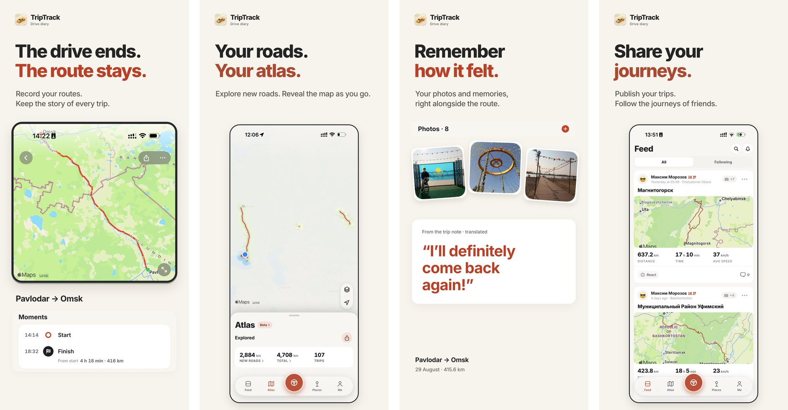

<p align="center">
  
</p>

<h1 align="center">TripTrack — Road Journal</h1>

<p align="center">
  <b>Every road you drive clears the fog on your own map.</b><br>
  A road trip diary for iPhone that records your drives and turns them into an atlas.
</p>

<p align="center">
  <a href="https://apps.apple.com/app/apple-store/id6760650361?pt=128553974&ct=github&mt=8"></a>
  <a href="https://apps.apple.com/ru/app/id6760650361"></a>
  
  
  <a href="LICENSE"></a>
  <a href="https://github.com/OneZee23/trip-track-ios/releases"></a>
</p>

<p align="center">
  <a href="https://apps.apple.com/app/apple-store/id6760650361?pt=128553974&ct=github&mt=8"></a>
</p>

<p align="center">
  <a href="https://trip-track.app">Website</a> ·
  <a href="https://apps.apple.com/app/apple-store/id6760650361?pt=128553974&ct=github&mt=8">App Store</a> ·
  <a href="CHANGELOG.md">Changelog</a> ·
  <a href="https://github.com/OneZee23/trip-track-ios/releases">Releases</a>
</p>

<p align="center">
  
</p>

## What it does

- **Records every drive.** Swipe to start, or let it start by itself when your phone connects to the car stereo. Works in the background, from the Lock Screen and with Live Activities.
- **Builds your Atlas.** The world starts under fog; every road you drive clears it. See exactly where you have been and how many kilometres of new roads you opened.
- **Remembers places.** Pass the same spot again and the app tells you how many times you have been there and how long the drive usually takes.
- **Keeps the story.** Photos, checkpoints, notes, speed and elevation on one trip page; multi-day trips fold into one journey.
- **Garage.** Several vehicles with their own odometer, fuel or electric consumption and cost per trip.
- **Private by default.** No account needed to record. A home privacy zone trims the start and end of anything you share.

Recording, history, the Atlas, places and sync are free. Optional **TripTrack PRO** adds profile and car card styles, avatar frames, route colours and manually added trips.

## Built with

SwiftUI and UIKit · MapKit · Metal (the fog layer) · Core Location and Core Motion · Core Data · StoreKit 2 · ActivityKit and WidgetKit · Sign in with Apple · Sentry. No third-party maps, no analytics SDKs.

About 610 Swift source files and 430 test files, built with XcodeGen — setup steps are in the Russian section below («Локальная разработка»).

## Status

**0.9.0** is live on the App Store (15 October 2026). Release history: [Releases](https://github.com/OneZee23/trip-track-ios/releases) and [CHANGELOG](CHANGELOG.md) (in Russian).

Made by one developer, [OneZee](https://github.com/OneZee23). Ideas and bug reports are welcome in [Issues](https://github.com/OneZee23/trip-track-ios/issues).

---

# TripTrack — автодневник поездок для iPhone

TripTrack сохраняет поездки, маршруты, фотографии и статистику. Начните запись,
поставьте отметку в интересном месте, а позже найдите поездку в истории или
посмотрите пройденные дороги в личном атласе.

[Сайт и веб-кабинет](https://trip-track.app) · [История изменений](CHANGELOG.md)

## Статус

В App Store — **0.9.0 (88)**, выпущена 15 октября 2026.
[История изменений](CHANGELOG.md) · [релизы на GitHub](https://github.com/OneZee23/trip-track-ios/releases)

## Возможности

- **Запись поездок.** Ручной запуск, фоновая запись, пауза и продолжение,
  скорость, время, расстояние и качество GPS. Автотрекинг может сохранять
  черновики, которые нужно подтвердить перед добавлением в историю и атлас.
- **История и детали.** Поиск, календарь, фильтры, маршрут с цветом по скорости,
  полноэкранная карта и воспроизведение поездки. Название, заметки, фотографии
  и отметки помогают вспомнить, что было по дороге.
- **Атлас и места.** Открытые дороги и регионы с датой первого въезда; виды
  «Туман», «Ночь» и «Клетки», постер атласа, сохранённые места и история посещений.
- **Гараж.** Несколько машин, одометр, расход и расчёт стоимости поездок.
  Поддерживаются топливные, электрические и гибридные автомобили.
- **Профиль.** Уровни, достижения, коллекция дорог и оформление.
- **Обмен поездками.** Подписки, реакции, публичные профили и карточки для
  отправки друзьям. Поездки приватны по умолчанию; публикацию выбирает владелец.
- **Вход через Apple и облачная синхронизация.** История и данные аккаунта
  синхронизируются между устройствами. Веб-кабинет на
  [trip-track.app](https://trip-track.app) позволяет смотреть синхронизированные
  поездки на карте с компьютера. Сервер и сайт находятся в отдельных проектах.
- **Приватная зона.** Дом отмечается локально. Координаты внутри выбранной зоны
  удаляются из отправляемых маршрутов, превью, фотографий и отметок;
  исходная запись остаётся на устройстве.
- **Live Activity.** Статус записи на экране блокировки и в Dynamic Island.
  Полноценное приложение для CarPlay пока не включено в релиз.

Основная запись, история, атлас и синхронизация бесплатны. В **0.8.4** добавлена
необязательная подписка **PRO**: дополнительное оформление и ручное добавление
поездок с построением маршрута по дорогам. Такие поездки учитываются в пробеге
и атласе, но не дают XP и достижений. Сохранённое платное оформление возвращается
после возобновления подписки. Разовые чаевые ничего не разблокируют.

Приложение поддерживает **13 языков**: русский, English, Deutsch, Español,
Français, Italiano, Polski, Türkçe, Bahasa Indonesia, Українська, Português,
Қазақша и Filipino. Есть системная, светлая и тёмная темы, метрические и
имперские единицы.

**Платформа:** iPhone, iOS 17 и новее. Android-версии пока нет.

## Технологии

| Область | Реализация |
|---|---|
| Интерфейс | SwiftUI, UIKit для карт и переходов |
| Карты и атлас | MapKit, Metal |
| Запись | Core Location, Core Motion |
| Локальные данные | Core Data, схема v23 |
| Аккаунт и синхронизация | Sign in with Apple, HTTP API, локальная очередь изменений |
| Подписка и чаевые | StoreKit 2 |
| Виджеты записи | ActivityKit, WidgetKit, App Intents |
| Диагностика | Sentry — внешняя зависимость через Swift Package Manager |
| Сборка | Swift 5.9, Xcode, XcodeGen |

## Локальная разработка

Нужны macOS, Xcode с установленным iOS SDK и XcodeGen. Минимальная версия
системы приложения — iOS 17.

1. Установите XcodeGen, например через Homebrew: `brew install xcodegen`.
2. Скопируйте `Local.xcconfig.example` в `Local.xcconfig` и задайте свои
   `DEVELOPMENT_TEAM`, `PRODUCT_BUNDLE_IDENTIFIER` и адреса API. Файл с локальными
   настройками исключён из Git; не перезаписывайте его, если он уже настроен.
3. Выполните `xcodegen generate` и откройте `TripTrack.xcodeproj`.
4. Выберите схему `TripTrack`, конфигурацию Debug и доступный симулятор или iPhone.

`project.yml` — источник конфигурации проекта. Изменения настроек вносите туда,
а затем повторно генерируйте проект. Для входа через Apple и синхронизации нужны
настроенные идентификаторы Apple и доступный сервер. В Debug адрес API отделён
от Release; пустой `SENTRY_DSN` отключает отправку диагностики.

Перед работой прочитайте [CLAUDE.md](CLAUDE.md): там правила проекта, команды
проверок и ограничения работы с пользовательскими данными. Unit-тесты находятся
в `TripTrackTests`, UI-сценарии — в `TripTrackUITests`. Результаты конкретной
релизной сборки фиксируются в документации кандидата, а не выводятся из номера
версии в проекте.

## Структура репозитория

```text
TripTrack/               iPhone-приложение: модели, запись, интерфейс, синхронизация
TripTrackShared/         общие модели и действия приложения и расширения
TripTrackLiveActivity/   Live Activity и Dynamic Island
TripTrackTests/          unit-тесты
TripTrackUITests/        UI-сценарии и проверки карт
Tools/                  инструменты разработки и подготовки ресурсов
docs/                   архитектура, тексты стора и документы релизов
project.yml             конфигурация XcodeGen
```

- [План и проверки 0.9.0](docs/releases/0.9.0/plan.md) — состав последнего
  релиза и выполненные проверки.
- [Чек-лист релиза](docs/releases/0.8.4/checklist.md) — подготовка и выпуск.
- [Навигация по документации](docs/README.md) — расположение материалов.
- [CHANGELOG](CHANGELOG.md) — история изменений; старые разделы описывают
  соответствующие версии, а не текущее состояние приложения.

## Лицензия

[MIT](LICENSE), © 2026 OneZee.
